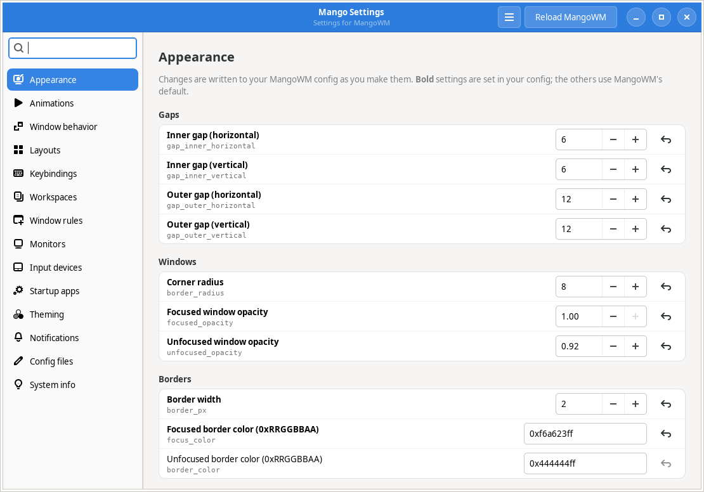
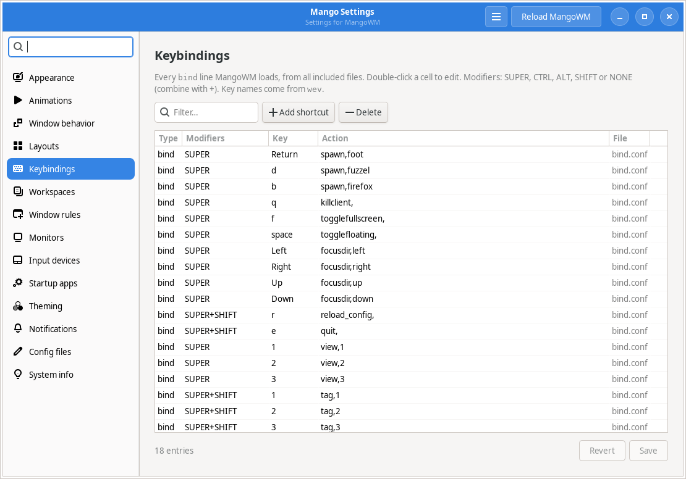
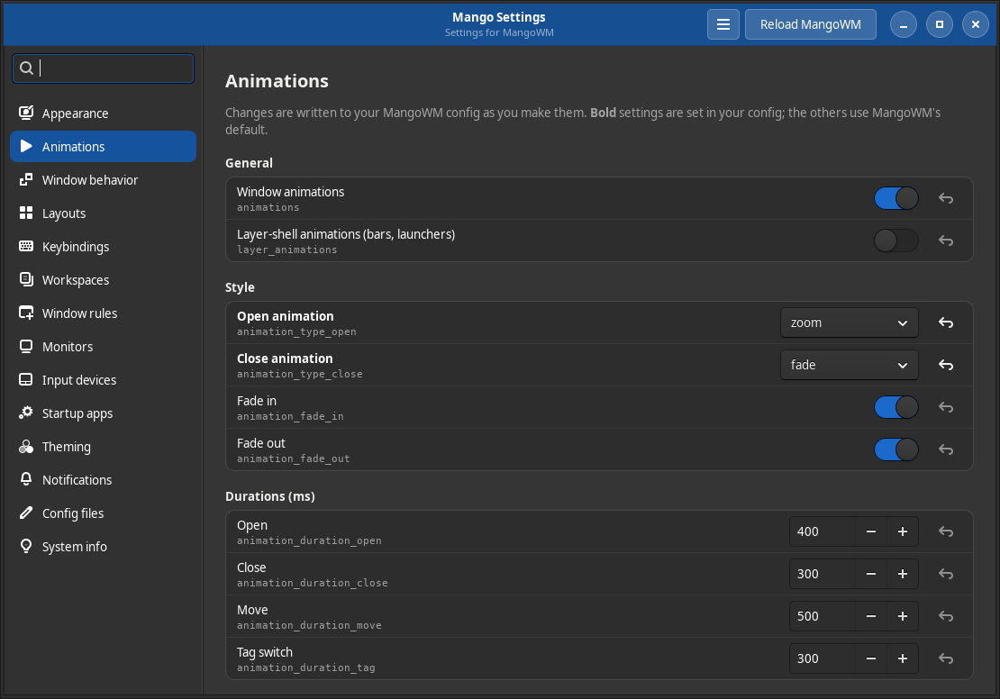

<p align="center">
  
</p>

<h1 align="center">Mango Settings</h1>

<p align="center">
  A GNOME-style settings app for the <a href="https://github.com/mangowm/mango">MangoWM</a> Wayland compositor.<br>
  One Python file, built with GTK 3 and PyGObject.
</p>

<p align="center">
  <a href="#install">Install</a> ·
  <a href="#try-it-without-installing">Try it</a> ·
  <a href="#pages">Pages</a> ·
  <a href="#how-your-config-is-handled">Config handling</a> ·
  <a href="#troubleshooting">Troubleshooting</a>
</p>



## Install

One command for any distro, no clone needed:

```sh
curl -fsSL https://raw.githubusercontent.com/code-smith404/MangoWM-Settings/main/install.sh | sh
```

<details>
<summary>Using <code>wget</code> instead</summary>

```sh
wget -qO- https://raw.githubusercontent.com/code-smith404/MangoWM-Settings/main/install.sh | sh
```
</details>

The installer is plain POSIX `sh`, so it also runs where `bash` isn't installed (Alpine, minimal Void, Debian's `dash`). It:

1. detects your distro from `/etc/os-release`, including derivatives such as Mint, Pop!_OS, EndeavourOS and CachyOS,
2. finds a Python that can load GTK 3, or offers to install PyGObject and GTK 3 with your package manager (using `sudo`, `doas` or `run0`),
3. installs the app into `~/.local` with no root needed:
   - `~/.local/share/mango-settings/mango-settings.py`
   - `~/.local/bin/mango-settings`, a small launcher that uses the Python it found, so pyenv, conda or a virtualenv on your `PATH` can't break it
   - a menu entry and icon, so it shows up in fuzzel, wofi, rofi and other app launchers
4. tells you if `~/.local/bin` isn't in your `PATH`.

Then run `mango-settings`, or open **Mango Settings** from your launcher. To update, run the same command again.

### Supported distros

Every distro marked "tested in CI" is installed into a fresh container on each change ([workflow](.github/workflows/ci.yml)).

| Family | Distros | Dependencies installed | Status |
| --- | --- | --- | --- |
| Arch | Arch, Manjaro, EndeavourOS, CachyOS, Garuda, Artix | `pacman -S python python-gobject gtk3` | tested in CI (Arch, Manjaro) |
| Debian | Debian, Ubuntu, Mint, Pop!_OS, elementary, Zorin, Kali | `apt-get install python3 python3-gi gir1.2-gtk-3.0` | tested in CI (Debian, Ubuntu 22.04 and latest) |
| Fedora / RHEL | Fedora, Nobara, RHEL, CentOS Stream, Rocky, AlmaLinux | `dnf install python3 python3-gobject gtk3` | tested in CI (Fedora, AlmaLinux 9) |
| Fedora Atomic | Silverblue, Kinoite, Sway Atomic | `rpm-ostree install python3-gobject gtk3` (then reboot) | supported, not tested in CI |
| openSUSE | Tumbleweed, Leap, SLE | `zypper install python3-gobject python3-gobject-Gdk typelib-1_0-Gtk-3_0` | tested in CI (Tumbleweed, Leap 16) |
| Void | Void (glibc and musl) | `xbps-install python3-gobject gtk+3` | tested in CI |
| Alpine | Alpine, postmarketOS, Chimera | `apk add python3 py3-gobject3 gtk+3.0` | tested in CI |
| Gentoo | Gentoo, Funtoo | `emerge dev-python/pygobject:3 x11-libs/gtk+:3` | supported, not tested in CI |
| Solus | Solus | `eopkg install python3-gobject gtk3` | supported, not tested in CI |
| NixOS | NixOS, Nix on any distro | the flake, or a `nix-shell` launcher | flake built in CI |

To see what the installer would run on your system without changing anything:

```sh
curl -fsSL https://raw.githubusercontent.com/code-smith404/MangoWM-Settings/main/install.sh | sh -s -- --print-deps
```

If your distro isn't detected, set `MANGO_SETTINGS_FAMILY` to one of `arch`, `debian`, `fedora`, `ostree`, `suse`, `void`, `alpine`, `gentoo`, `solus` or `nix`, for example `... | MANGO_SETTINGS_FAMILY=debian sh`.

### Installer options

Pass options with `sh -s --`:

```sh
curl -fsSL https://raw.githubusercontent.com/code-smith404/MangoWM-Settings/main/install.sh | sh -s -- --system
```

| Option | What it does |
| --- | --- |
| `--system` | Install for all users into `/usr/local` (uses `sudo`, `doas` or `run0`) |
| `--prefix DIR` | Install into `DIR` instead of `~/.local` |
| `--ref REF` | Install a specific branch or tag (default `main`) |
| `--deps` | Install missing dependencies without asking |
| `--no-deps` | Skip the dependency check |
| `--print-deps` | Show the detected distro and the dependency command, then exit |
| `--uninstall` | Remove Mango Settings (use the same `--prefix`/`--system` you installed with) |

### Uninstall

```sh
curl -fsSL https://raw.githubusercontent.com/code-smith404/MangoWM-Settings/main/install.sh | sh -s -- --uninstall
```

Your MangoWM config is never touched by uninstalling.

### Try it without installing

Run it straight from GitHub; nothing is written to disk except your own config changes:

```sh
curl -fsSL https://raw.githubusercontent.com/code-smith404/MangoWM-Settings/main/mango-settings.py | python3 -
```

You can pass flags too: `... | python3 - --page Keybindings`. This needs PyGObject and GTK 3 (see [Requirements](#requirements)).

On NixOS or anywhere with Nix flakes:

```sh
nix run github:code-smith404/MangoWM-Settings
```

### Packages

<details>
<summary>Arch Linux (PKGBUILD)</summary>

An AUR-ready [`PKGBUILD`](packaging/arch/PKGBUILD) for `mango-settings-git` is included:

```sh
git clone https://github.com/code-smith404/MangoWM-Settings.git
cd MangoWM-Settings/packaging/arch
makepkg -si
```
</details>

<details>
<summary>NixOS (flake)</summary>

Install into your profile:

```sh
nix profile install github:code-smith404/MangoWM-Settings
```

Or add it to your system flake:

```nix
{
  inputs.mango-settings.url = "github:code-smith404/MangoWM-Settings";
  # ...
  environment.systemPackages = [ inputs.mango-settings.packages.${pkgs.system}.default ];
}
```

An overlay is available as `overlays.default`.
</details>

<details>
<summary>Other distros and packagers (Makefile)</summary>

```sh
git clone https://github.com/code-smith404/MangoWM-Settings.git
cd MangoWM-Settings
sudo make install PREFIX=/usr          # or: make install PREFIX=/usr DESTDIR="$pkgdir"
sudo make uninstall PREFIX=/usr
```
</details>

### Manual install

```sh
git clone https://github.com/code-smith404/MangoWM-Settings.git
cd MangoWM-Settings
./mango-settings.py        # run from the clone
./install.sh               # or install it (uses the local files)
```

### Requirements

MangoWM, Python 3.8+, PyGObject and GTK 3. Optional:
- `mmsg` (part of MangoWM), for reloading and detecting monitors
- `gsettings` (from GLib), for the Theming page

| Distro | Command |
| --- | --- |
| Arch / Manjaro / EndeavourOS / CachyOS | `sudo pacman -S --needed python-gobject gtk3` |
| Debian / Ubuntu / Mint / Pop!_OS | `sudo apt install python3-gi gir1.2-gtk-3.0` |
| Fedora / RHEL / Rocky / Alma | `sudo dnf install python3-gobject gtk3` |
| Fedora Atomic | `rpm-ostree install python3-gobject gtk3` |
| openSUSE | `sudo zypper install python3-gobject python3-gobject-Gdk typelib-1_0-Gtk-3_0` |
| Void | `sudo xbps-install python3-gobject gtk+3` |
| Alpine / postmarketOS | `doas apk add py3-gobject3 gtk+3.0` |
| Gentoo | `sudo emerge dev-python/pygobject:3 x11-libs/gtk+:3` |
| Solus | `sudo eopkg install python3-gobject gtk3` |
| NixOS | `nix run github:code-smith404/MangoWM-Settings` |

## Pages

| Page | What you can change |
| --- | --- |
| **Appearance** | Gaps, corner radius, opacity, border width and colors, blur, shadows |
| **Animations** | Open/close animation types (`none`, `fade`, `slide`, `zoom`), fades, durations |
| **Window behavior** | Sloppy focus, cursor warp, new-window placement, floating snap, smart gaps, auto reload |
| **Layouts** | Master factor and count, scroller proportion, dwindle options, layout cycling |
| **Keybindings** | Every `bind` line from all included files, with conflict warnings and key modes |
| **Workspaces** | `tag_rule` entries, such as the layout for each tag |
| **Window rules** | `window_rule` and `window_rule_once` entries |
| **Monitors** | `monitor_rule` entries, plus "Add connected displays" through `mmsg` |
| **Input devices** | Keyboard layout and repeat, Num Lock, cursor theme and size, touchpad, mouse |
| **Startup apps** | `exec_once` and `exec` commands |
| **Theming** | GTK theme, icon theme, cursor theme, color scheme and font (via GSettings) |
| **Notifications** | Detects swaync, mako, dunst or fnott; edit, reload and send a test notification |
| **Config files** | Raw editor for every config file, warnings for files that aren't included |
| **System info** | MangoWM version, OS, kernel, session, CPU, memory, uptime; copy to clipboard |

<table>
  <tr>
    <td></td>
    <td></td>
  </tr>
  <tr>
    <td align="center">Keybindings</td>
    <td align="center">Animations, dark mode</td>
  </tr>
</table>

Settings in **bold** are set in your config. The others show MangoWM's built-in default, and the reset button next to a setting removes it from your config again. Simple settings save as you change them. List pages (keybindings, rules, monitors, startup apps) have **Save** and **Revert** buttons.

## Usage

```
mango-settings [--page PAGE] [--config FILE] [--list-pages] [--version]
```

| Flag | Meaning |
| --- | --- |
| `--page Keybindings` | Open a specific page (see `--list-pages`) |
| `--config FILE` | Edit a different root config, like `mango -c FILE` |
| `--list-pages` | Print the page names |
| `--version` | Print the version |

Keyboard shortcuts: <kbd>Ctrl</kbd>+<kbd>F</kbd> search settings, <kbd>Ctrl</kbd>+<kbd>S</kbd> save the current page, <kbd>Ctrl</kbd>+<kbd>R</kbd> reload MangoWM, <kbd>Ctrl</kbd>+<kbd>Q</kbd> quit.

The app's own light/dark/system appearance is in the menu (☰).

Example MangoWM keybinding to open it:

```ini
bind=SUPER,i,spawn,mango-settings
```

## How your config is handled

- **Same lookup as MangoWM.** It uses `~/.config/mango/config.conf`, or the file passed with `--config`.
- **Included files are followed.** `source=` and `source_optional=` lines are read in order, with `./` relative to the config folder and `~/` meaning your home folder. A setting is changed where MangoWM actually reads it. If a key appears more than once, the last one wins, just like in MangoWM.
- **Your files stay yours.** Comments, blank lines, ordering and inline comments are kept, and only the lines you change are rewritten. Symlinks (for example from GNU Stow or a dotfiles repo) and file permissions are preserved. Writes are atomic, so a crash never leaves a half-written config.
- **Backups.** Before the first change to a file in a session, a copy goes to `~/.cache/mango-settings/backups/<date-time>/`. You can open it from the **Config files** page.
- **External edits are detected.** Files are re-read before every write. If a file changed on disk while you had unsaved list edits, the app asks before overwriting.
- **Applying changes.** MangoWM reloads its config automatically when `auto_reload_config` is on (the default). Otherwise press **Reload MangoWM**, which runs `mmsg dispatch reload_config`.
- **TOML configs** (`config.toml`) are shown read-only for now. Use the **Config files** page to edit them.
- **No config yet?** The app offers to copy MangoWM's default config into `~/.config/mango/`.

## Troubleshooting

<details>
<summary><code>ModuleNotFoundError: No module named 'gi'</code> or <code>Namespace Gtk not available</code></summary>

PyGObject or GTK 3 is missing. Install them with the command for your distro from [Requirements](#requirements), or run the installer, which does it for you. If you use pyenv, conda or a virtualenv, run the app with your system Python (`/usr/bin/python3`), because that's where your distro installs PyGObject. The installed `mango-settings` launcher already does this.
</details>

<details>
<summary><code>mango-settings: command not found</code></summary>

`~/.local/bin` is not in your `PATH`. Add this to your shell profile, or run `~/.local/bin/mango-settings`:

```bash
export PATH="$HOME/.local/bin:$PATH"
```
</details>

<details>
<summary>Changes don't take effect</summary>

Make sure MangoWM is running and `mmsg` is installed, then press <kbd>Ctrl</kbd>+<kbd>R</kbd>. Some options, such as monitor modes and input devices, only apply to newly connected devices or after restarting MangoWM.
</details>

<details>
<summary>Something went wrong with my config</summary>

Restore the copy from `~/.cache/mango-settings/backups/`. Every file is backed up before its first change in a session.
</details>

## Development

```bash
make test                               # config engine tests, no display needed
make lint                               # pyflakes + shellcheck
docker run --rm -v "$PWD:/src" fedora sh /src/tests/distro-test.sh   # installer test in a distro container
```

The config engine (parsing, `source` resolution, writing) is plain Python and has no GTK dependency, so it can be tested on its own. Bug reports and pull requests are welcome.

## License

[MIT](LICENSE) © 2026 Harikesh Verma ([code-smith404](https://github.com/code-smith404))
